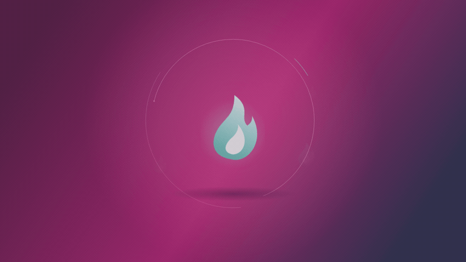
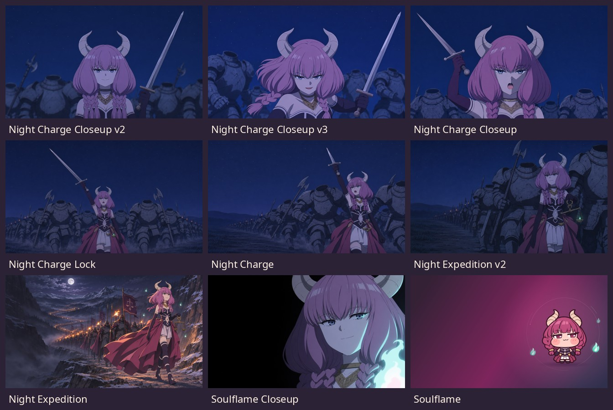
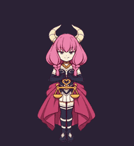
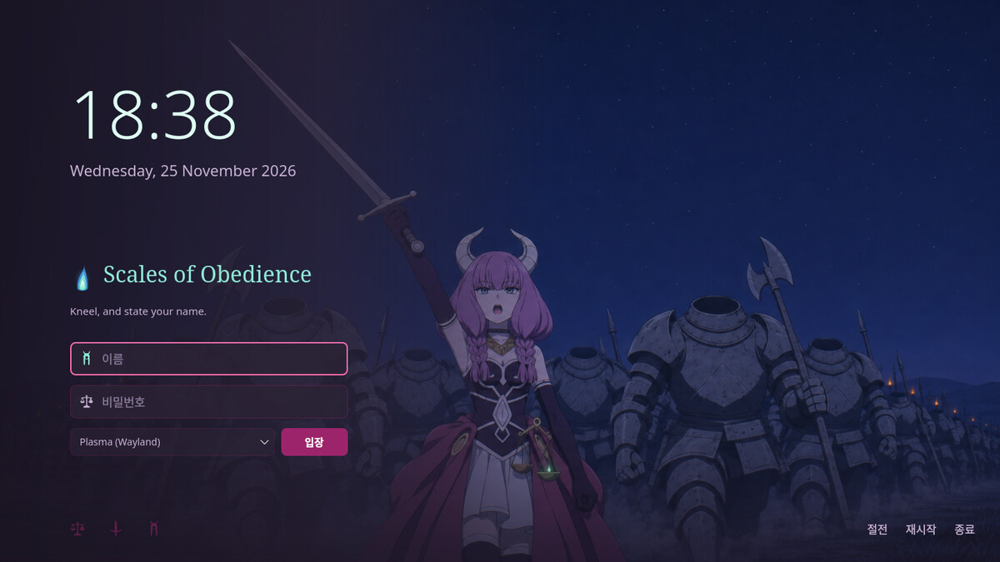
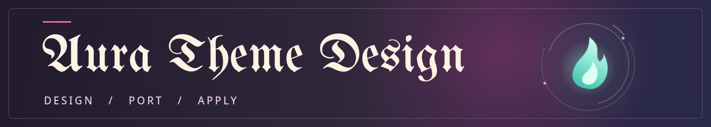

# 

**English** · [한국어](docs/README.ko.md) · [简体中文](docs/README.zh-CN.md) · [日本語](docs/README.ja.md)

[Install the theme](#theme-setup) · [Install the AI skill](#agent-skill) · [Browse the collection](#included-assets)

Aura Soulflame is an **unofficial fan-made desktop theme** inspired by Aura from the anime *Frieren: Beyond Journey’s End*. Rights in the character and the original work belong to their respective rights holders. [Official Aura character page](https://frieren-anime.jp/character/chara_group2/2-2/)

A desktop theme in plum, pink and mint. The full collection includes the character art, animated cursors, wallpapers, Codex pet, Aura Symbols, and native themes for KDE Plasma, Kitty, Orca, SDDM, GRUB and Plymouth.



**Splash** (`plasma-splash`) plays after login as Plasma starts. [Static preview](docs/splash.png)

## What each component does

### KDE Plasma 6

| Colors | Night |
| --- | --- |
|  |  |
| `plasma-colors` sets window, text, focus, and selection colors. Choose **Aura Soulflame (Portable)** in System Settings → Colors. | `plasma-lock` adds **Aura Soulflame Night**, the flame scene under Screen Locking → Appearance → Wallpaper type. |

| Drift | Panel |
| --- | --- |
|  |  |
| `plasma-drift` animates embers over a gradient or your own image. Choose **Aura Soulflame Drift** in the desktop or lock-screen wallpaper picker. Turn off animation in the wallpaper's settings. | `plasma-panel` adds a flame to the panel or desktop. In Edit Mode → Add Widgets, choose **Aura Soulflame Panel**. Click the flame to wake it. |

To turn on the splash, choose **Aura Soulflame Splash** in System Settings → Splash Screen.

### Kitty


`kitty` supplies the background, foreground, cursor, selection, tab, and ANSI colors. Preview with `kitty --config <path-to-aura-soulflame.conf>`. To keep the palette, add `include aura-soulflame.conf` after any competing preset in `kitty.conf`. Set `KITTY_CONFIG_DIRECTORY` for the installer if Kitty uses a different config directory.

### Your own assets

| Module | What you provide | Where you use it |
| --- | --- | --- |
| `cursor` | An extracted Xcursor theme with `index.theme` and `cursors/` | Linux desktop or compositor cursor settings |
| `wallpapers` | Local PNG, JPEG, or WebP files | Your OS wallpaper picker |
| `codex-pet` | `pet.json` and its referenced sprite sheet | Codex pet picker. In a compatible terminal, run `/pets` and search by the manifest ID. |
| Plasma portraits | Transparent PNGs for each pose used by the chosen component | Splash, Night, or Panel in place of the default flame |

See the [asset pack layout](docs/assets.md) for file names and `--assets` examples. For another terminal or desktop, map the roles and 16 ANSI colors in [palette.json](resources/palette.json) to its native theme format.

<a name="included-assets"></a>

## Included artwork and themes



[Browse all six wallpapers](assets/character/wallpapers) · [Character sheets and portraits](assets/character/art)

| Animated Xcursor presets | Codex pet |
| --- | --- |
|  |  |
| [Animated Xcursor presets](assets/cursors) | [Codex pet](assets/character/pet) |

| SDDM | Aura Symbols |
| --- | --- |
|  |  |
| [Aura SDDM login screen](themes/sddm/aura-soulflame) | [AuraSymbols.otf](themes/sddm/aura-soulflame/AuraSymbols.otf) |

Linux example for the included art. Select the modules your desktop supports.

```sh
python3 aura.py plan --assets assets/character --modules cursor wallpapers codex-pet
python3 aura.py install --assets assets/character --modules cursor wallpapers codex-pet
```

Orca IDE, the KDE lock screen, Plasma style and icons, the SDDM login screen, and the GRUB and Plymouth boot themes each have their own steps. [See the full install and activation guide](docs/extended-themes.md)

<a name="theme-setup"></a>

## Install and apply

Clone the repository, or download the [full theme ZIP](https://github.com/Bum-Boo/aura-soulflame/releases/download/v0.2.1/aura-soulflame-v0.2.1.zip) and open the extracted folder.

```sh
git clone https://github.com/Bum-Boo/aura-soulflame.git
cd aura-soulflame
```

Run these commands from the repository root with **Python 3.9 or newer**. The Kitty example is for Linux or macOS. Plasma modules require KDE Plasma 6 on Linux. On Windows, use `py -3 aura.py` for local wallpapers or a Codex pet.

```sh
python3 aura.py list
python3 aura.py plan --modules kitty
python3 aura.py install --modules kitty
python3 aura.py status --modules kitty
```

On Linux, use the same sequence with `--modules plasma-colors plasma-splash` to install the Plasma palette and splash. Add other module names as needed. The plan shows the actual destinations under your user's config and data directories. After installation, select the component in the app or desktop settings shown above.

To switch back, first select your previous theme or remove the Kitty include. Then run `python3 aura.py uninstall --modules kitty`, using the modules you installed. If you edited an installed file, the installer reports `modified` and keeps it in place.

<a name="agent-skill"></a>

## 

Use the skill to design an Aura theme, port the palette to another app, or apply the KDE and Kitty modules. It carries the palette, Kitty preset, CSS exporter, and contrast checker. [Download the skill ZIP](https://github.com/Bum-Boo/aura-soulflame/releases/latest/download/aura-theme-design.zip) · [Read the skill](.agents/skills/aura-theme-design/SKILL.md)

### 1. Choose your agent

Open this checkout directly if your agent discovers `.agents/skills/`. For reuse in other projects, extract `aura-theme-design/` into **one** of the locations below. The destination should contain `aura-theme-design/SKILL.md`.

| Agent | User-wide folder | Project-only folder | How to invoke |
| --- | --- | --- | --- |
| Codex | `~/.agents/skills/` | `.agents/skills/` | `$aura-theme-design`. [Docs](https://developers.openai.com/codex/skills) |
| Claude Code | `~/.claude/skills/` | `.claude/skills/` | `/aura-theme-design`. [Docs](https://code.claude.com/docs/en/skills) |
| Cursor | `~/.cursor/skills/` | `.agents/skills/` | Find `aura-theme-design` in the chat `/` menu. [Docs](https://cursor.com/docs/skills) |
| Gemini CLI | `~/.gemini/skills/` | `.agents/skills/` | `/skills reload`, then ask to use `aura-theme-design`. [Docs](https://geminicli.com/docs/cli/skills/) |
| GitHub Copilot CLI / VS Code | `~/.copilot/skills/` | `.github/skills/` | Ask to use the `aura-theme-design` skill in an agent session. [Copilot](https://docs.github.com/en/copilot/concepts/customizations/agent-skills) · [VS Code](https://code.visualstudio.com/docs/agent-customization/agent-skills) |
| OpenCode | `~/.config/opencode/skills/` | `.opencode/skills/` | Ask it to load the `aura-theme-design` skill. [Docs](https://opencode.ai/docs/skills/) |
| Google Antigravity | `~/.gemini/config/skills/` | `.agents/skills/` | Ask by name in the app. In CLI, use `/aura-theme-design`. [Docs](https://antigravity.google/docs/skills) |

### 2. Download and install

**Linux or macOS** · Use `curl` and `unzip`. Set `skill_dir` to the folder in your agent's row, for example `"$HOME/.claude/skills"` for Claude Code. The commands below use Codex's user-wide folder and keep an existing skill directory in place.

```sh
(
  skill_dir="$HOME/.agents/skills"
  skill_path="$skill_dir/aura-theme-design"
  if [ -e "$skill_path" ] || [ -L "$skill_path" ]; then
    printf 'Skill already exists at %s\n' "$skill_path" >&2
    exit 1
  fi

  temp_dir=$(mktemp -d) || exit 1
  trap 'rm -f "$temp_dir/aura-theme-design.zip"; rmdir "$temp_dir"' EXIT
  curl -fL https://github.com/Bum-Boo/aura-soulflame/releases/latest/download/aura-theme-design.zip \
    -o "$temp_dir/aura-theme-design.zip" &&
    mkdir -p "$skill_dir" &&
    unzip -qn "$temp_dir/aura-theme-design.zip" -d "$skill_dir" &&
    test -f "$skill_path/SKILL.md"
)
```

**Windows PowerShell** · Set `$skillDir` to the folder in your agent's row, for example `Join-Path $HOME '.claude/skills'` for Claude Code. For a project install, run the commands inside the project and use its relative path.

```powershell
$skillDir = Join-Path $HOME '.agents/skills'
$skillPath = Join-Path $skillDir 'aura-theme-design'
if (Test-Path -LiteralPath $skillPath) { throw "Skill already exists at $skillPath" }

$zip = Join-Path ([IO.Path]::GetTempPath()) ("aura-theme-design-{0}.zip" -f [guid]::NewGuid())
try {
  Invoke-WebRequest -Uri 'https://github.com/Bum-Boo/aura-soulflame/releases/latest/download/aura-theme-design.zip' `
    -OutFile $zip -UseBasicParsing -ErrorAction Stop
  New-Item -ItemType Directory -Path $skillDir -Force -ErrorAction Stop | Out-Null
  Expand-Archive -LiteralPath $zip -DestinationPath $skillDir -ErrorAction Stop
  if (!(Test-Path -LiteralPath (Join-Path $skillPath 'SKILL.md'))) { throw 'SKILL.md was not extracted' }
} finally {
  Remove-Item -LiteralPath $zip -ErrorAction SilentlyContinue
}
```

### 3. Apply or preview

Start a new agent session or reload its skills, then invoke using the last column above. If your agent takes a plain prompt, use this one.

> Use `aura-theme-design` for my current desktop or app. Show a preview first, preserve my settings, and tell me how to verify and undo the result. I use `<OS / desktop / app>`. My optional asset pack is at `<path>`.

For the actual KDE and Kitty install, open the [theme checkout or download](#theme-setup) on the machine you want to theme. Give the local agent that path so it can run `aura.py` and check the app.

**Upload or attach**

- **Claude web** · In **Customize → Skills**, create a skill and choose **Upload a skill**. Select the original ZIP. [Docs](https://support.claude.com/en/articles/12512180-use-skills-in-claude)
- **ChatGPT** · If your workspace offers skill uploads, open **Skills → Create → Upload from your computer** and select the skill archive. [Docs](https://help.openai.com/en/articles/20001066-skills-in-chatgpt)
- **Other assistants** · Attach the ZIP or share the whole extracted `aura-theme-design/` folder. Ask the assistant to read `SKILL.md` and use the bundled files. A hosted chat can prepare a config for you to save. Give a local agent access to the target machine for live activation.

## License

The [MIT license](LICENSE) covers only the original code, scripts, configuration, and theme files. That includes colors, palettes, QML, the installer, documentation text, and original graphics that do not depict Aura, such as the abstract flame frames.

It does not grant any right in the character artwork, in Aura, or in *Frieren: Beyond Journey’s End*. Those rights stay with their holders. Images that depict Aura are for personal, non-commercial fan use only. They were generated with OpenAI's GPT image generation, they are not part of the MIT license, and they cannot be relicensed. The excluded paths and terms are in [ASSETS-LICENSE](ASSETS-LICENSE).

The Aura Symbols font is excluded too, because its head glyph depicts Aura. Recolored Breeze icons and the Daemon-based Plasma style keep their own LGPL notices.

[AI application guide](docs/apply-with-ai.md) · [Module catalog](modules.json) · [Credits](docs/credits.md) · [License](#license)

The previews show the theme running on KDE Plasma 6 and Kitty in an isolated Linux session. Run `python3 -m unittest discover -s tests -v` to check installer behavior.
