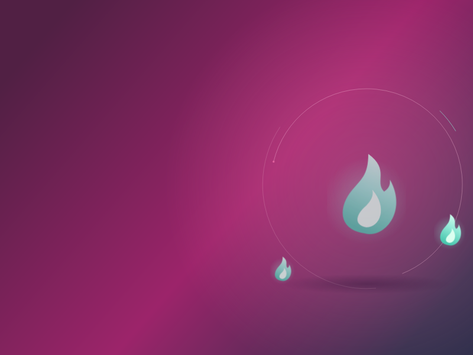

# 

[English](../README.md) · [한국어](README.ko.md) · [简体中文](README.zh-CN.md) · **日本語**

[テーマをインストール](#theme-setup) · [AI スキルをインストール](#agent-skill) · [同梱内容を見る](#included-assets)

深いプラム色にピンクの選択色とミント色の炎を合わせたデスクトップテーマです。キャラクター素材、アニメーションカーソル、壁紙、Codex ペット、Aura Symbols フォントと、KDE Plasma、Kitty、Orca、SDDM、GRUB、Plymouth のテーマを収録しています。


**スプラッシュ画面**（`plasma-splash`）は、ログイン後の Plasma 起動中に表示されます。[静止画で見る](splash.png)

## コンポーネントごとの機能

### KDE Plasma 6

| 配色 | 夜のロック画面 |
| --- | --- |
|  |  |
| `plasma-colors` はウィンドウ、文字、フォーカス、選択範囲の色を設定します。システム設定の**色**で **Aura Soulflame (Portable)** を選びます。 | `plasma-lock` は炎のあるロック画面の壁紙を追加します。**画面ロック → 外観 → 壁紙の種類**で **Aura Soulflame Night** を選びます。 |

| 舞い上がる火の粉 | パネルウィジェット |
| --- | --- |
|  |  |
| `plasma-drift` はグラデーションや手持ちの画像に火の粉を重ねます。デスクトップまたはロック画面の壁紙設定で **Aura Soulflame Drift** を選びます。壁紙の設定でアニメーションをオフにできます。 | `plasma-panel` はパネルやデスクトップに小さな炎を置きます。**編集モード → ウィジェットを追加**で **Aura Soulflame Panel** を選びます。炎をクリックすると明るくなります。 |

ログイン時のアニメーションは、システム設定の**スプラッシュ画面**で **Aura Soulflame Splash** を選ぶと有効になります。

### Kitty ターミナル


`kitty` には背景、文字、カーソル、選択範囲、タブ、ANSI 16 色の設定が含まれます。`kitty --config <aura-soulflame.conf のパス>` で別ウィンドウに表示して確認できます。普段の設定に適用するには、`kitty.conf` の既存の配色プリセットより後に `include aura-soulflame.conf` を追加します。Kitty が別の設定ディレクトリを使っている場合は、インストール時に `KITTY_CONFIG_DIRECTORY` をその場所に設定します。

### 手持ちの素材を使う

| コンポーネント | 用意するファイル | 適用場所 |
| --- | --- | --- |
| `cursor` | `index.theme` と `cursors/` が入った Xcursor テーマのディレクトリ | Linux のデスクトップ環境やコンポジターのカーソル設定 |
| `wallpapers` | PNG、JPEG、WebP 形式の壁紙 | OS の壁紙選択画面 |
| `codex-pet` | `pet.json` と、そこから参照されるスプライトシート | Codex のペット選択画面。対応ターミナルでは `/pets` を開き、マニフェストの ID で検索します。 |
| Plasma のキャラクター画像 | 各コンポーネントで使用するポーズに対応した透過 PNG | スプラッシュ、夜の壁紙、パネルで標準の炎を置き換えます。 |

ファイル名や `--assets` の使い方は[素材パックの構成](assets.md)を参照してください。別のターミナルやデスクトップに配色を移すときは、[共通パレット](../resources/palette.json)の用途別の色と ANSI 16 色を、そのアプリのテーマ設定に対応させます。

<a name="included-assets"></a>

## 収録イラストとテーマ


[壁紙 9 枚を見る](../assets/character/wallpapers) · [キャラクター設定画とポートレート](../assets/character/art)

| アニメーションカーソル | Codex ペット |
| --- | --- |
|  |  |
| [アニメーションカーソル](../assets/cursors) | [Codex ペット](../assets/character/pet) |

| SDDM | Aura Symbols |
| --- | --- |
|  |  |
| [Aura SDDM ログイン画面](../themes/sddm/aura-soulflame) | [AuraSymbols.otf](../themes/sddm/aura-soulflame/AuraSymbols.otf) |

以下は Linux でカーソル、壁紙、ペットを導入する例です。必要なものを選んで実行してください。

```sh
python3 aura.py plan --assets assets/character --modules cursor wallpapers codex-pet
python3 aura.py install --assets assets/character --modules cursor wallpapers codex-pet
```

Orca IDE、KDE のロック画面、Plasma のスタイルとアイコン、SDDM のログイン画面、GRUB と Plymouth の起動テーマにも対応しています。 [インストールと有効化のガイド](extended-themes.md)

<a name="theme-setup"></a>

## インストールと適用

以下のコマンドでリポジトリを取得するか、[テーマ一式の ZIP](https://github.com/Bum-Boo/aura-soulflame/releases/download/v0.2.0/aura-soulflame-v0.2.0.zip)をダウンロードして展開してください。

```sh
git clone https://github.com/Bum-Boo/aura-soulflame.git
cd aura-soulflame
```

**Python 3.9 以上**を使い、リポジトリのルートで実行します。下の Kitty の例は Linux と macOS 向けです。Plasma のコンポーネントには Linux 上の KDE Plasma 6 が必要です。Windows で壁紙や Codex ペットを取り込む場合は `py -3 aura.py` を使います。

```sh
python3 aura.py list
python3 aura.py plan --modules kitty
python3 aura.py install --modules kitty
python3 aura.py status --modules kitty
```

Linux で Plasma の配色とスプラッシュをまとめて入れる場合は、同じ手順で `--modules plasma-colors plasma-splash` を指定します。`plan` で実際の配置先を確認し、インストール後に上の表にあるアプリやデスクトップの設定から有効にします。

元に戻すときは、以前のテーマに戻すか Kitty の `include` 行を削除してから、対象のモジュールを指定して `python3 aura.py uninstall --modules kitty` を実行します。インストール後に編集したファイルは `modified` と表示され、その場所に残ります。

<a name="agent-skill"></a>

## 

Aura 風のテーマを作ったり、別のアプリに配色を移植したり、KDE と Kitty に適用したりするためのスキルです。共通パレット、Kitty の配色プリセット、CSS の書き出し、コントラストの確認ツールが入っています。[スキル ZIP をダウンロード](https://github.com/Bum-Boo/aura-soulflame/releases/latest/download/aura-theme-design.zip) · [スキルの本文を読む](../.agents/skills/aura-theme-design/SKILL.md)

### 1. エージェントと配置先を選ぶ

`.agents/skills/` を探すエージェントなら、このリポジトリを開くと使えます。ほかのプロジェクトでも使う場合は、表から配置先を**ひとつ**選び、そこに `aura-theme-design/` フォルダーを展開します。配置先に `aura-theme-design/SKILL.md` があることを確認してください。

| エージェント | ユーザー全体 | 現在のプロジェクトのみ | 呼び出し方 |
| --- | --- | --- | --- |
| Codex | `~/.agents/skills/` | `.agents/skills/` | `$aura-theme-design` を入力。[公式ガイド](https://developers.openai.com/codex/skills) |
| Claude Code | `~/.claude/skills/` | `.claude/skills/` | `/aura-theme-design` を入力。[公式ガイド](https://code.claude.com/docs/en/skills) |
| Cursor | `~/.cursor/skills/` | `.agents/skills/` | チャットの `/` メニューから `aura-theme-design` を選択。[公式ガイド](https://cursor.com/docs/skills) |
| Gemini CLI | `~/.gemini/skills/` | `.agents/skills/` | `/skills reload` を実行してから `aura-theme-design` の使用を依頼。[公式ガイド](https://geminicli.com/docs/cli/skills/) |
| GitHub Copilot CLI / VS Code | `~/.copilot/skills/` | `.github/skills/` | エージェントのセッションで `aura-theme-design` の使用を依頼。[Copilot](https://docs.github.com/en/copilot/concepts/customizations/agent-skills) · [VS Code](https://code.visualstudio.com/docs/agent-customization/agent-skills) |
| OpenCode | `~/.config/opencode/skills/` | `.opencode/skills/` | `aura-theme-design` スキルを読み込むように依頼。[公式ガイド](https://opencode.ai/docs/skills/) |
| Google Antigravity | `~/.gemini/config/skills/` | `.agents/skills/` | アプリではスキル名を指定。CLI では `/aura-theme-design` を入力。[公式ガイド](https://antigravity.google/docs/skills) |

### 2. ダウンロードして配置する

**Linux・macOS** · `curl` と `unzip` が必要です。`skill_dir` を利用するエージェントの配置先に変更します。たとえば Claude Code では `"$HOME/.claude/skills"` を指定します。下の例では Codex のユーザー全体で使える場所に展開し、同名の既存フォルダーを保持します。

```sh
(
  skill_dir="$HOME/.agents/skills"
  skill_path="$skill_dir/aura-theme-design"
  if [ -e "$skill_path" ] || [ -L "$skill_path" ]; then
    printf 'Skill already exists at %s\n' "$skill_path" >&2
    exit 1
  fi

  temp_dir=$(mktemp -d) || exit 1
  trap 'rm -f "$temp_dir/aura-theme-design.zip"; rmdir "$temp_dir"' EXIT
  curl -fL https://github.com/Bum-Boo/aura-soulflame/releases/latest/download/aura-theme-design.zip \
    -o "$temp_dir/aura-theme-design.zip" &&
    mkdir -p "$skill_dir" &&
    unzip -qn "$temp_dir/aura-theme-design.zip" -d "$skill_dir" &&
    test -f "$skill_path/SKILL.md"
)
```

**Windows PowerShell** · `$skillDir` を利用するエージェントの配置先に変更します。たとえば Claude Code では `Join-Path $HOME '.claude/skills'` を使います。プロジェクトだけで使う場合は、そのディレクトリで実行し、表の相対パスを指定します。

```powershell
$skillDir = Join-Path $HOME '.agents/skills'
$skillPath = Join-Path $skillDir 'aura-theme-design'
if (Test-Path -LiteralPath $skillPath) { throw "Skill already exists at $skillPath" }

$zip = Join-Path ([IO.Path]::GetTempPath()) ("aura-theme-design-{0}.zip" -f [guid]::NewGuid())
try {
  Invoke-WebRequest -Uri 'https://github.com/Bum-Boo/aura-soulflame/releases/latest/download/aura-theme-design.zip' `
    -OutFile $zip -UseBasicParsing -ErrorAction Stop
  New-Item -ItemType Directory -Path $skillDir -Force -ErrorAction Stop | Out-Null
  Expand-Archive -LiteralPath $zip -DestinationPath $skillDir -ErrorAction Stop
  if (!(Test-Path -LiteralPath (Join-Path $skillPath 'SKILL.md'))) { throw 'SKILL.md was not extracted' }
} finally {
  Remove-Item -LiteralPath $zip -ErrorAction SilentlyContinue
}
```

### 3. 適用またはプレビューする

新しいエージェントセッションを開くかスキル一覧を再読み込みしてから、表の方法で呼び出します。通常のチャットでは次のように頼めます。

> `aura-theme-design` を使い、今のデスクトップやアプリに Aura テーマを合わせてください。先にプレビューを表示し、既存設定を保ってください。確認方法と元に戻す方法も教えてください。環境は `<OS / デスクトップ / アプリ>` で、任意の素材パックは `<パス>` にあります。

KDE や Kitty に適用するには、対象の PC で[テーマのリポジトリを開くか、全体の ZIP を取得します](#theme-setup)。その場所をローカルエージェントに伝えると、`aura.py` を実行し、アプリで反映を確認できます。

**アップロードまたは添付する**

- **Claude のウェブ版** · **Customize → Skills** でスキルを作成し、**Upload a skill** を選んで元の ZIP をアップロードします。[公式ガイド](https://support.claude.com/en/articles/12512180-use-skills-in-claude)
- **ChatGPT** · スキルのアップロードが有効なワークスペースで、**Skills → Create → Upload from your computer** を開き、スキルのアーカイブを選びます。[公式ガイド](https://help.openai.com/en/articles/20001066-skills-in-chatgpt)
- **そのほかのアシスタント** · ZIP または展開した `aura-theme-design/` フォルダー全体を添付し、`SKILL.md` と参照先のファイルを読むように頼みます。ウェブのチャットでは保存用の設定を作れます。実際の適用は対象 PC にアクセスできるローカルエージェントに任せます。

[AI 向け適用ガイド](apply-with-ai.md) · [モジュール一覧](../modules.json) · [出典とクレジット](credits.md) · [MIT ライセンス](../LICENSE)

プレビューは分離した Linux 環境で KDE Plasma 6 と Kitty を実際に動かして撮影しました。インストーラーの動作は `python3 -m unittest discover -s tests -v` で確認できます。
