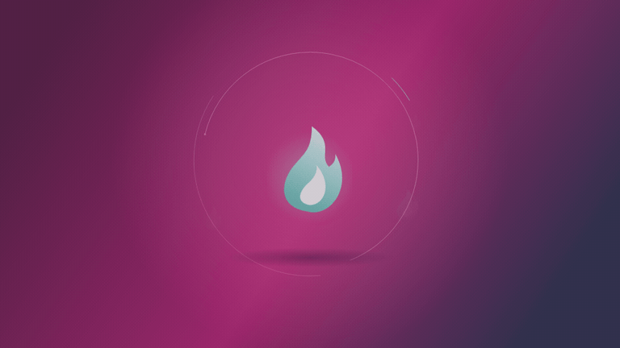
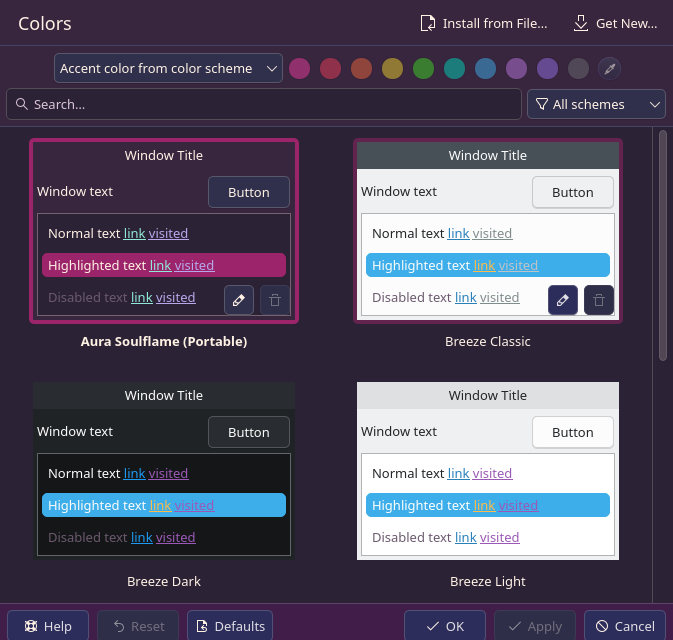
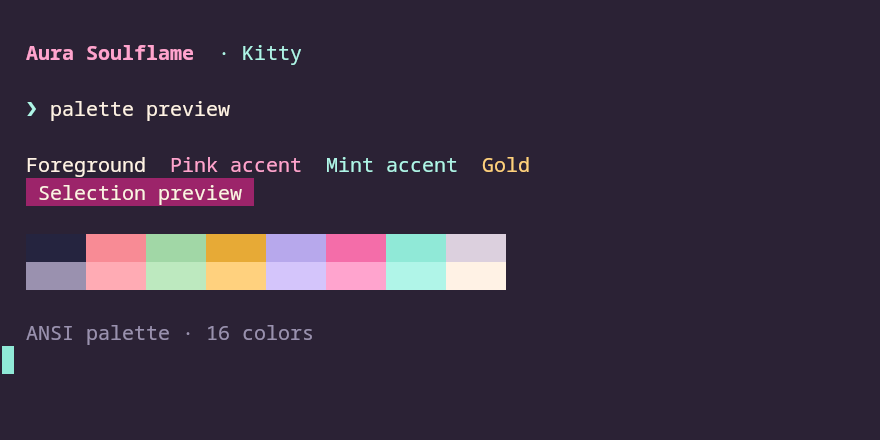

# Aura Soulflame

[English](../README.md) · [한국어](README.ko.md) · [简体中文](README.zh-CN.md) · **日本語**

プラム色の背景、ピンクの選択色、ミント色の炎を使ったデスクトップテーマです。Plasma のエフェクトや Kitty の配色を個別に使えます。手持ちの壁紙、カーソル、Codex ペットも取り込めます。



**スプラッシュ画面**（`plasma-splash`）は、ログイン後の Plasma 起動中に表示されます。[静止画で見る](splash.png)

## コンポーネントごとの機能

### KDE Plasma 6

| 配色 | 夜のロック画面 |
| --- | --- |
|  |  |
| `plasma-colors` はウィンドウ、文字、フォーカス、選択範囲の色を設定します。システム設定の**色**で **Aura Soulflame (Portable)** を選びます。 | `plasma-lock` は炎のあるロック画面の壁紙を追加します。**画面ロック → 外観 → 壁紙の種類**で **Aura Soulflame Night** を選びます。 |

| 舞い上がる火の粉 | パネルウィジェット |
| --- | --- |
|  |  |
| `plasma-drift` はグラデーションや手持ちの画像に火の粉を重ねます。デスクトップまたはロック画面の壁紙設定で **Aura Soulflame Drift** を選びます。壁紙の設定でアニメーションをオフにできます。 | `plasma-panel` はパネルやデスクトップに小さな炎を置きます。**編集モード → ウィジェットを追加**で **Aura Soulflame Panel** を選びます。炎をクリックすると明るくなります。 |

ログイン時のアニメーションは、システム設定の**スプラッシュ画面**で **Aura Soulflame Splash** を選ぶと有効になります。

### Kitty ターミナル



`kitty` には背景、文字、カーソル、選択範囲、タブ、ANSI 16 色の設定が含まれます。`kitty --config <aura-soulflame.conf のパス>` で別ウィンドウに表示して確認できます。普段の設定に適用するには、`kitty.conf` の既存の配色プリセットより後に `include aura-soulflame.conf` を追加します。Kitty が別の設定ディレクトリを使っている場合は、インストール時に `KITTY_CONFIG_DIRECTORY` をその場所に設定します。

### 手持ちの素材を使う

| コンポーネント | 用意するファイル | 適用場所 |
| --- | --- | --- |
| `cursor` | `index.theme` と `cursors/` が入った Xcursor テーマのディレクトリ | Linux のデスクトップ環境やコンポジターのカーソル設定 |
| `wallpapers` | PNG、JPEG、WebP 形式の壁紙 | OS の壁紙選択画面 |
| `codex-pet` | `pet.json` と、そこから参照されるスプライトシート | Codex のペット選択画面。対応ターミナルでは `/pets` を開き、マニフェストの ID で検索します。 |
| Plasma のキャラクター画像 | 各コンポーネントで使用するポーズに対応した透過 PNG | スプラッシュ、夜の壁紙、パネルで標準の炎を置き換えます。 |

ファイル名や `--assets` の使い方は[素材パックの構成](assets.md)を参照してください。別のターミナルやデスクトップに配色を移すときは、[共通パレット](../resources/palette.json)の用途別の色と ANSI 16 色を、そのアプリのテーマ設定に対応させます。

## インストールと適用

**Python 3.9 以上**を使い、リポジトリのルートで実行します。下の Kitty の例は Linux と macOS 向けです。Plasma のコンポーネントには Linux 上の KDE Plasma 6 が必要です。Windows で壁紙や Codex ペットを取り込む場合は `py -3 aura.py` を使います。

```sh
python3 aura.py list
python3 aura.py plan --modules kitty
python3 aura.py install --modules kitty
python3 aura.py status --modules kitty
```

Linux で Plasma の配色とスプラッシュをまとめて入れる場合は、同じ手順で `--modules plasma-colors plasma-splash` を指定します。`plan` で実際の配置先を確認し、インストール後に上の表にあるアプリやデスクトップの設定から有効にします。

元に戻すときは、以前のテーマに戻すか Kitty の `include` 行を削除してから、対象のモジュールを指定して `python3 aura.py uninstall --modules kitty` を実行します。インストール後に編集したファイルは `modified` と表示され、その場所に残ります。

## AI アシスタントに適用を頼む

[aura-theme-design スキル](../.agents/skills/aura-theme-design/SKILL.md)は、新しいテーマの設計、別のアプリへの配色の移植、配布コンポーネントの適用に使えます。Kitty の配色プリセット、CSS 変数の書き出し、コントラストの確認ツールが含まれます。

> `$aura-theme-design` を使い、今のデスクトップやアプリに Aura Soulflame を合わせてください。既存設定を保ちながら、まずプレビューを見せてください。反映を確かめる方法と、元に戻す方法も教えてください。任意の素材パックは `<パス>` にあります。

[スキル ZIP をダウンロード](https://github.com/Bum-Boo/aura-soulflame/releases/latest/download/aura-theme-design.zip) · [スキルの導入と AI 向け適用ガイド](apply-with-ai.md) · [モジュール一覧](../modules.json) · [出典とクレジット](credits.md) · [MIT ライセンス](../LICENSE)

プレビューは分離した Linux 環境で KDE Plasma 6 と Kitty を実際に動かして撮影しました。インストーラーの動作は `python3 -m unittest discover -s tests -v` で確認できます。
