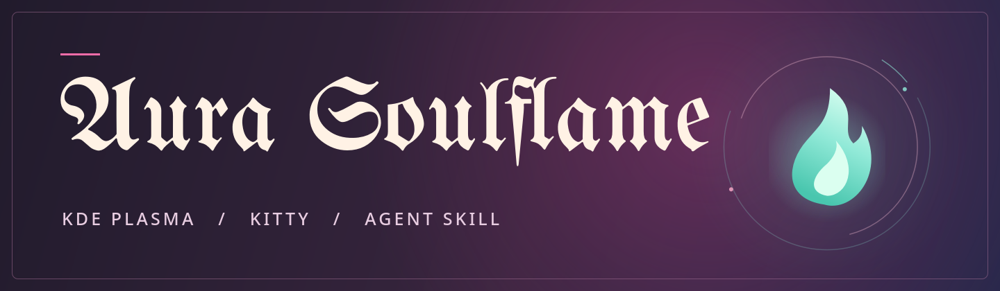
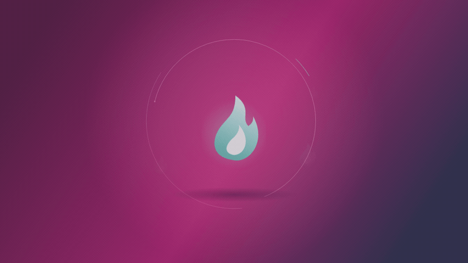
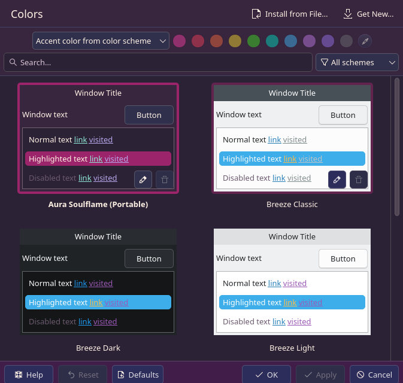
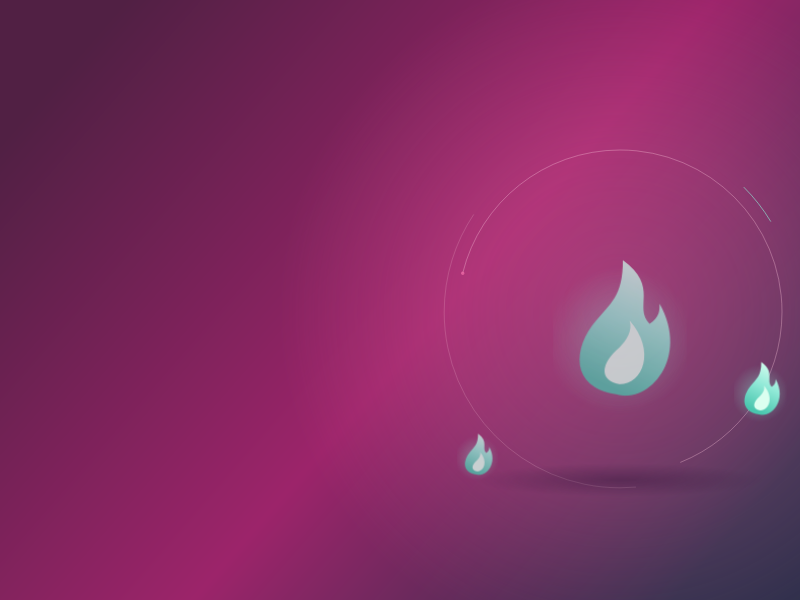
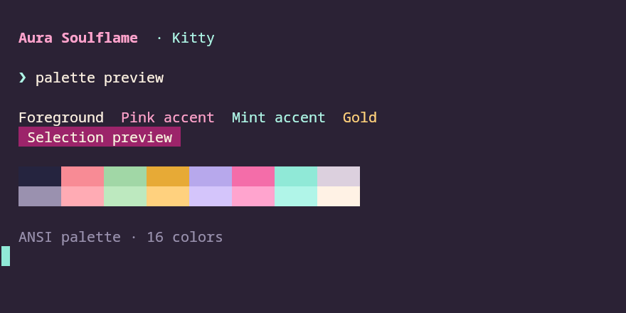
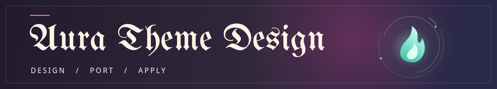

# 

[English](../README.md) · **한국어** · [简体中文](README.zh-CN.md) · [日本語](README.ja.md)

[테마 설치](#theme-setup) · [AI 스킬 설치](#agent-skill)

짙은 자주색 배경, 분홍색 선택 강조, 민트색 불꽃을 담은 데스크톱 테마예요. KDE 효과와 Kitty 색상표를 골라 쓰고, 가지고 있는 배경화면·커서·코덱스 펫도 가져올 수 있어요.



**시작 화면**(`plasma-splash`)은 로그인 후 Plasma가 시작될 때 재생돼요. [정지 화면으로 보기](splash.png)

## 구성별로 무엇이 달라지나요?

### KDE Plasma 6

| 색 구성 | 야간 잠금화면 |
| --- | --- |
|  |  |
| `plasma-colors`는 창, 글자, 포커스, 선택 영역의 색을 바꿔요. 시스템 설정의 **색 구성**에서 **Aura Soulflame (Portable)**을 고르세요. | `plasma-lock`은 불꽃이 떠 있는 잠금화면 배경을 추가해요. **화면 잠금 → 모양 → 배경화면 유형**에서 **Aura Soulflame Night**를 고르세요. |

| 떠오르는 불티 | 패널 위젯 |
| --- | --- |
|  |  |
| `plasma-drift`는 그라데이션이나 내가 고른 이미지 위에 불티를 띄워요. 바탕화면이나 잠금화면 배경 설정에서 **Aura Soulflame Drift**를 고르세요. 설정에서 애니메이션을 끌 수 있어요. | `plasma-panel`은 패널이나 바탕화면에 작은 불꽃을 올려요. **편집 모드 → 위젯 추가**에서 **Aura Soulflame Panel**을 고르고, 불꽃을 클릭하면 밝아져요. |

시작 화면은 시스템 설정의 **시작 화면**에서 **Aura Soulflame Splash**를 선택하면 돼요.

### Kitty 터미널



`kitty`에는 배경·글자·커서·선택 영역·탭·ANSI 색이 들어 있어요. `kitty --config <aura-soulflame.conf 경로>`로 별도 창에서 먼저 볼 수 있어요. 계속 쓰려면 `kitty.conf`에서 기존 색상 프리셋 아래에 `include aura-soulflame.conf`를 추가하세요. Kitty가 다른 설정 폴더를 쓰면 설치할 때 `KITTY_CONFIG_DIRECTORY`를 그 폴더로 지정하세요.

### 가지고 있는 파일 쓰기

| 구성 | 준비할 파일 | 적용 위치 |
| --- | --- | --- |
| `cursor` | `index.theme`와 `cursors/`가 있는 Xcursor 테마 폴더 | Linux 데스크톱이나 컴포지터의 커서 설정 |
| `wallpapers` | PNG, JPEG, WebP 배경화면 | 운영체제의 배경화면 선택기 |
| `codex-pet` | `pet.json`과 여기에 지정된 스프라이트 시트 | Codex 펫 선택기. 호환 터미널에서는 `/pets`를 열고 `pet.json`의 ID로 검색해요. |
| Plasma 초상화 | 구성에서 쓰는 포즈별 투명 PNG | 시작 화면, 야간 배경, 패널에서 기본 불꽃 대신 사용 |

[에셋 폴더 형식](assets.md)에서 파일 이름과 `--assets` 사용 예시를 볼 수 있어요. 다른 터미널이나 데스크톱에 색을 옮길 때는 [공통 팔레트](../resources/palette.json)의 역할별 색과 ANSI 16색을 해당 앱의 테마 설정에 매핑하면 돼요.

<a name="theme-setup"></a>

## 설치하고 적용하기

아래 명령으로 저장소를 받거나 [전체 테마 ZIP](https://github.com/Bum-Boo/aura-soulflame/releases/download/v0.1.0/aura-soulflame-v0.1.0.zip)을 내려받아 압축을 푸세요.

```sh
git clone https://github.com/Bum-Boo/aura-soulflame.git
cd aura-soulflame
```

**Python 3.9 이상**으로 저장소 루트에서 실행하세요. 아래 Kitty 예시는 Linux와 macOS에서 사용할 수 있어요. KDE 구성은 Linux의 Plasma 6이 필요하고, Windows에서 배경화면이나 펫을 가져올 때는 `py -3 aura.py`를 사용하세요.

```sh
python3 aura.py list
python3 aura.py plan --modules kitty
python3 aura.py install --modules kitty
python3 aura.py status --modules kitty
```

Linux에서 KDE 색과 시작 화면을 함께 쓰려면 같은 명령에서 `--modules plasma-colors plasma-splash`를 지정하세요. `plan`에서 파일이 들어갈 경로를 확인하고, 설치 뒤 위 표에 나온 앱이나 데스크톱 설정에서 활성화하세요.

되돌리려면 이전 테마를 선택하거나 Kitty의 `include` 줄을 제거한 뒤, 설치한 모듈에 대해 `python3 aura.py uninstall --modules kitty`를 실행하세요. 설치 후 편집한 파일은 `modified`로 표시되고 그대로 남아요.

<a name="agent-skill"></a>

## 

Aura 테마를 새로 디자인하거나, 다른 앱에 팔레트를 옮기거나, KDE·Kitty 구성을 적용하는 스킬이에요. 공통 팔레트, Kitty 프리셋, CSS 내보내기, 명암 대비 검사 도구가 들어 있어요. [스킬 ZIP 다운로드](https://github.com/Bum-Boo/aura-soulflame/releases/latest/download/aura-theme-design.zip) · [스킬 원문 보기](../.agents/skills/aura-theme-design/SKILL.md)

### 1. 에이전트별 설치 위치 선택

`.agents/skills/`를 읽는 에이전트라면 이 저장소를 열어서 쓸 수 있어요. 다른 프로젝트에서도 쓰려면 표에서 설치 위치 **하나**를 골라 `aura-theme-design/` 폴더를 넣으세요. 설치 위치 아래에 `aura-theme-design/SKILL.md`가 있으면 돼요.

| 에이전트 | 사용자 전체 | 현재 프로젝트 | 불러오는 방법 |
| --- | --- | --- | --- |
| Codex | `~/.agents/skills/` | `.agents/skills/` | `$aura-theme-design` 입력. [공식 문서](https://developers.openai.com/codex/skills) |
| Claude Code | `~/.claude/skills/` | `.claude/skills/` | `/aura-theme-design` 입력. [공식 문서](https://code.claude.com/docs/en/skills) |
| Cursor | `~/.cursor/skills/` | `.agents/skills/` | 채팅의 `/` 메뉴에서 `aura-theme-design` 선택. [공식 문서](https://cursor.com/docs/skills) |
| Gemini CLI | `~/.gemini/skills/` | `.agents/skills/` | `/skills reload` 후 `aura-theme-design`을 쓰라고 요청. [공식 문서](https://geminicli.com/docs/cli/skills/) |
| GitHub Copilot CLI / VS Code | `~/.copilot/skills/` | `.github/skills/` | 에이전트 세션에서 `aura-theme-design` 스킬을 쓰라고 요청. [Copilot](https://docs.github.com/en/copilot/concepts/customizations/agent-skills) · [VS Code](https://code.visualstudio.com/docs/agent-customization/agent-skills) |
| OpenCode | `~/.config/opencode/skills/` | `.opencode/skills/` | `aura-theme-design` 스킬을 불러오라고 요청. [공식 문서](https://opencode.ai/docs/skills/) |
| Google Antigravity | `~/.gemini/config/skills/` | `.agents/skills/` | 앱에서는 이름으로 요청하고, CLI에서는 `/aura-theme-design` 입력. [공식 문서](https://antigravity.google/docs/skills) |

### 2. 다운로드하고 설치

**Linux·macOS** · `curl`과 `unzip`이 필요해요. `skill_dir`를 사용하는 에이전트의 폴더로 바꾸세요. 예를 들어 Claude Code는 `"$HOME/.claude/skills"`를 쓰면 돼요. 아래는 Codex 사용자 전체에 설치하는 예시예요. 같은 이름의 폴더가 있으면 기존 파일을 보존해요.

```sh
(
  skill_dir="$HOME/.agents/skills"
  skill_path="$skill_dir/aura-theme-design"
  if [ -e "$skill_path" ] || [ -L "$skill_path" ]; then
    printf 'Skill already exists at %s\n' "$skill_path" >&2
    exit 1
  fi

  temp_dir=$(mktemp -d) || exit 1
  trap 'rm -f "$temp_dir/aura-theme-design.zip"; rmdir "$temp_dir"' EXIT
  curl -fL https://github.com/Bum-Boo/aura-soulflame/releases/latest/download/aura-theme-design.zip \
    -o "$temp_dir/aura-theme-design.zip" &&
    mkdir -p "$skill_dir" &&
    unzip -qn "$temp_dir/aura-theme-design.zip" -d "$skill_dir" &&
    test -f "$skill_path/SKILL.md"
)
```

**Windows PowerShell** · `$skillDir`를 사용하는 에이전트의 폴더로 바꾸세요. 예를 들어 Claude Code는 `Join-Path $HOME '.claude/skills'`를 쓰면 돼요. 현재 프로젝트에만 설치하려면 프로젝트에서 명령을 실행하고 표의 상대 경로를 지정하세요.

```powershell
$skillDir = Join-Path $HOME '.agents/skills'
$skillPath = Join-Path $skillDir 'aura-theme-design'
if (Test-Path -LiteralPath $skillPath) { throw "Skill already exists at $skillPath" }

$zip = Join-Path ([IO.Path]::GetTempPath()) ("aura-theme-design-{0}.zip" -f [guid]::NewGuid())
try {
  Invoke-WebRequest -Uri 'https://github.com/Bum-Boo/aura-soulflame/releases/latest/download/aura-theme-design.zip' `
    -OutFile $zip -UseBasicParsing -ErrorAction Stop
  New-Item -ItemType Directory -Path $skillDir -Force -ErrorAction Stop | Out-Null
  Expand-Archive -LiteralPath $zip -DestinationPath $skillDir -ErrorAction Stop
  if (!(Test-Path -LiteralPath (Join-Path $skillPath 'SKILL.md'))) { throw 'SKILL.md was not extracted' }
} finally {
  Remove-Item -LiteralPath $zip -ErrorAction SilentlyContinue
}
```

### 3. 적용하거나 미리 보기

새 에이전트 세션을 열거나 스킬 목록을 새로고침한 뒤, 표의 방법으로 불러오세요. 일반 채팅 입력으로는 이렇게 요청할 수 있어요.

> `aura-theme-design`을 써서 내 데스크톱이나 앱에 Aura 테마를 맞춰 줘. 먼저 미리보기를 보여 주고 기존 설정을 보존해 줘. 확인하고 되돌리는 방법도 알려 줘. 환경은 `<OS / 데스크톱 / 앱>`이고, 에셋 팩은 `<경로>`에 있어.

KDE·Kitty에 실제로 적용하려면 대상 PC에서 [테마 저장소를 열거나 전체 ZIP을 받으세요](#theme-setup). 로컬 에이전트에 그 경로를 알려 주면 `aura.py`를 실행하고 앱에서 반영 여부를 확인할 수 있어요.

**업로드하거나 첨부하기**

- **Claude 웹** · **Customize → Skills**에서 새 스킬을 만들고 **Upload a skill**을 선택해 ZIP을 올리세요. [공식 문서](https://support.claude.com/en/articles/12512180-use-skills-in-claude)
- **ChatGPT** · 스킬 업로드가 활성화된 워크스페이스에서 **Skills → Create → Upload from your computer**를 열고 스킬 압축 파일을 선택하세요. [공식 문서](https://help.openai.com/en/articles/20001066-skills-in-chatgpt)
- **그 밖의 에이전트** · ZIP이나 풀어 놓은 `aura-theme-design/` 폴더 전체를 첨부하세요. `SKILL.md`와 그 안에서 가리키는 파일을 읽으라고 요청하면 돼요. 웹 채팅은 저장할 설정 파일을 만들 수 있고, 실제 적용은 대상 PC에 접근할 수 있는 로컬 에이전트에 맡기세요.

[AI 적용 가이드](apply-with-ai.md) · [모듈 목록](../modules.json) · [출처와 크레딧](credits.md) · [MIT 라이선스](../LICENSE)

미리보기는 격리된 Linux 환경에서 KDE Plasma 6과 Kitty를 실행해 촬영했어요. 설치 도구는 `python3 -m unittest discover -s tests -v`로 점검할 수 있어요.
