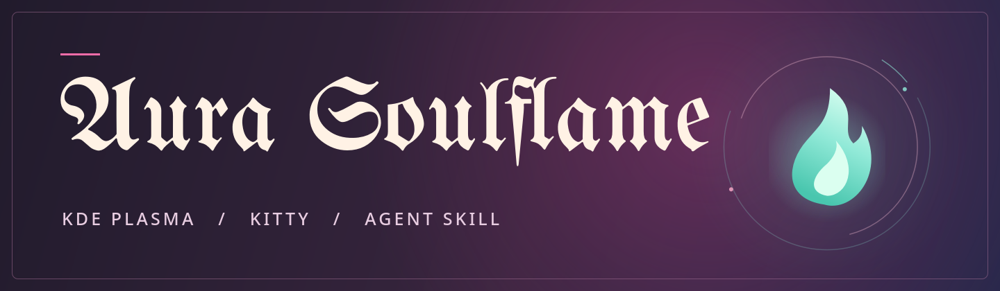
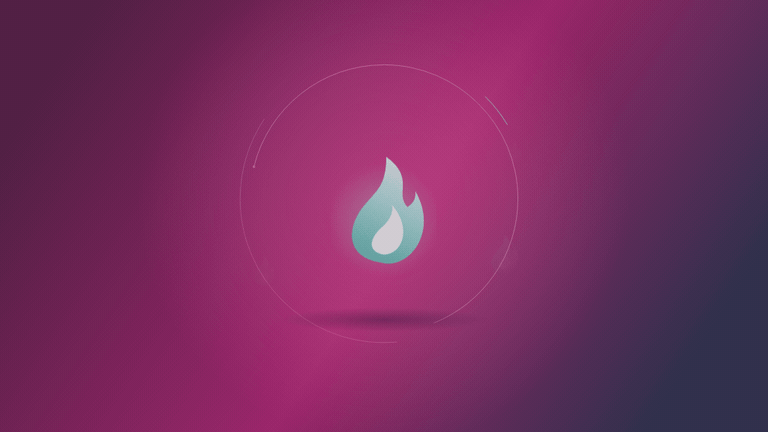
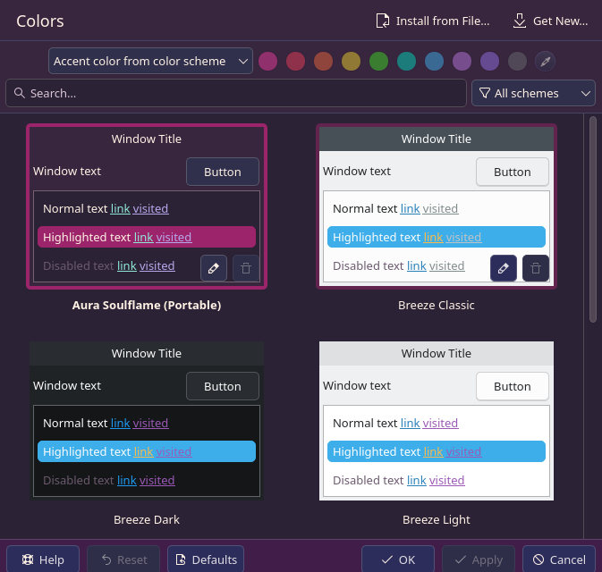
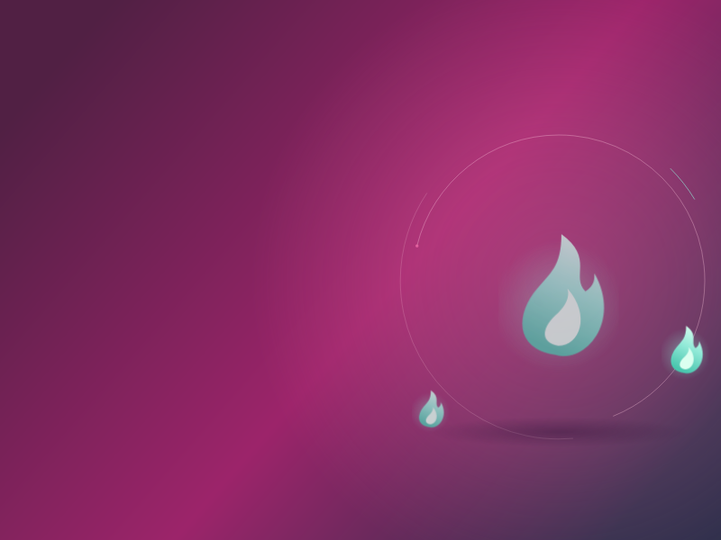
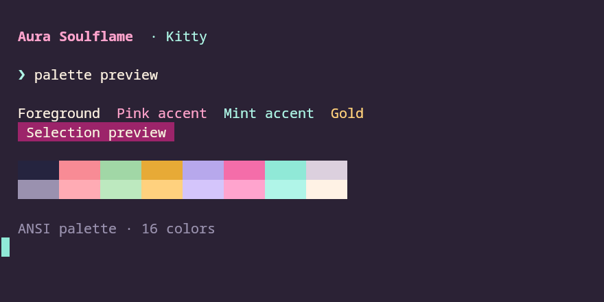
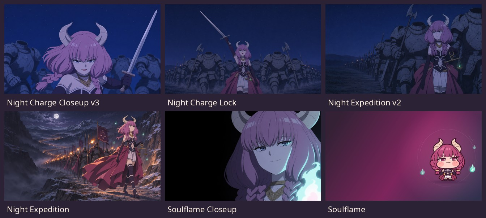
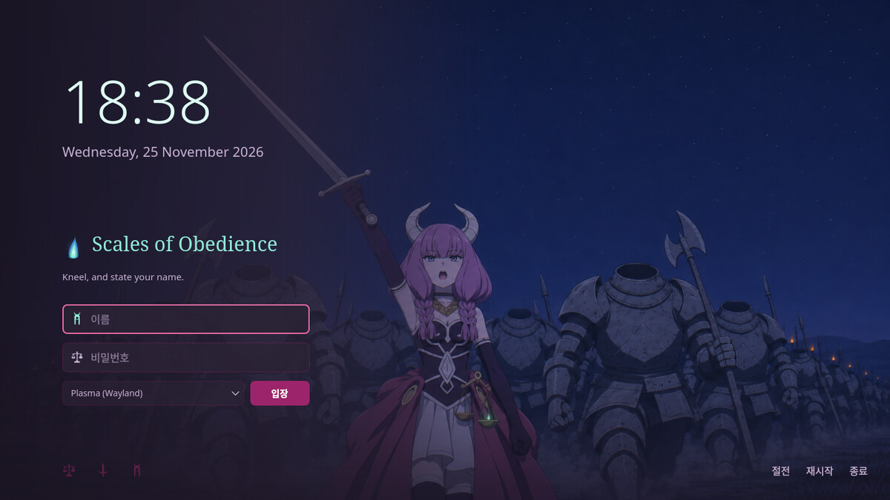
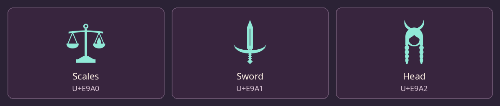
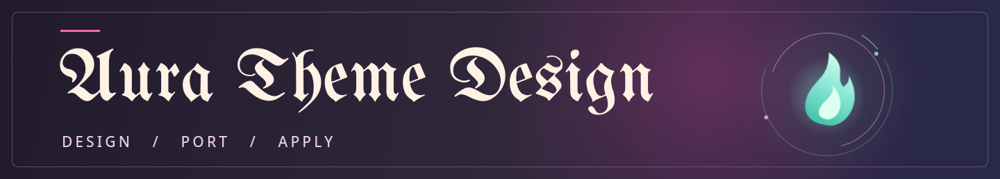

# 

[English](../README.md) · [한국어](README.ko.md) · **简体中文** · [日本語](README.ja.md)

[安装主题](#theme-setup) · [安装 AI 技能](#agent-skill) · [查看完整内容](#included-assets)

Aura Soulflame 是以动画《葬送的芙莉莲》中的阿乌拉为灵感制作的**非官方同人主题**。角色与原作的权利归各自权利人所有。 [官方角色介绍](https://frieren-anime.jp/character/chara_group2/2-2/)

以深梅色、粉色和薄荷绿为主色的桌面主题。整套资源含角色图、动态鼠标指针、壁纸、Codex 宠物、Aura 符号字体，以及 KDE Plasma、Kitty、Orca、SDDM、GRUB 和 Plymouth 主题。



**启动画面**（`plasma-splash`）会在登录后、Plasma 正在启动时播放。[查看静态预览](splash.png)

## 各个组件有什么用？

### KDE Plasma 6

| 系统配色 | 夜间锁屏壁纸 |
| --- | --- |
|  |  |
| `plasma-colors` 设置窗口、文字、焦点和选区的颜色。在系统设置的**颜色**中选择 **Aura Soulflame (Portable)**。 | `plasma-lock` 添加带火焰的锁屏壁纸。打开**锁屏 → 外观 → 壁纸类型**，选择 **Aura Soulflame Night**。 |

| 漂浮火星 | 面板部件 |
| --- | --- |
|  |  |
| `plasma-drift` 让火星在渐变背景或自选图片上漂浮。在桌面或锁屏的壁纸设置中选择 **Aura Soulflame Drift**。也可以在壁纸设置里关闭动画。 | `plasma-panel` 可以在面板或桌面放置一簇小火焰。在**编辑模式 → 添加部件**中选择 **Aura Soulflame Panel**，点击火焰即可点亮它。 |

在系统设置的**启动画面**中选择 **Aura Soulflame Splash** 即可启用登录动画。

### Kitty 终端



`kitty` 提供背景、文字、光标、选区、标签页和 16 色 ANSI 配色。先用 `kitty --config <aura-soulflame.conf 的路径>` 在新窗口里预览。要长期使用，在 `kitty.conf` 的其他配色预设后加入 `include aura-soulflame.conf`。如果 Kitty 使用其他配置目录，安装时将 `KITTY_CONFIG_DIRECTORY` 指向该目录。

### 导入自己的素材

| 组件 | 需要准备的文件 | 应用位置 |
| --- | --- | --- |
| `cursor` | 含 `index.theme` 和 `cursors/` 的 Xcursor 主题目录 | Linux 桌面环境或合成器的光标设置 |
| `wallpapers` | PNG、JPEG 或 WebP 壁纸 | 操作系统的壁纸选择器 |
| `codex-pet` | `pet.json` 及其中引用的精灵图表 | Codex 宠物选择器。使用兼容终端时，执行 `/pets` 后按清单中的 ID 搜索。 |
| Plasma 角色图 | 对应组件所需姿势的透明 PNG | 在启动画面、夜间壁纸或面板中替换默认火焰 |

[素材目录格式](assets.md)列出了文件名和 `--assets` 用法。要在其他终端或桌面环境中使用配色，可以参考[共享色板](../resources/palette.json)中的颜色用途和 16 色 ANSI 色值，填入目标应用的主题配置。

<a name="included-assets"></a>

## 随附美术资源与主题



[查看六张壁纸](../assets/character/wallpapers) · [角色设定图与立绘](../assets/character/art)

| 动态鼠标指针 | Codex 宠物 |
| --- | --- |
|  |  |
| [动态鼠标指针](../assets/cursors) | [Codex 宠物](../assets/character/pet) |

| SDDM | Aura Symbols |
| --- | --- |
|  |  |
| [Aura SDDM 登录界面](../themes/sddm/aura-soulflame) | [AuraSymbols.otf](../themes/sddm/aura-soulflame/AuraSymbols.otf) |

下例在 Linux 上安装指针、壁纸和宠物。请按需选择组件。

```sh
python3 aura.py plan --assets assets/character --modules cursor wallpapers codex-pet
python3 aura.py install --assets assets/character --modules cursor wallpapers codex-pet
```

指南也涵盖 Orca IDE、KDE 锁屏、Plasma 样式和图标、SDDM 登录界面，以及 GRUB 和 Plymouth 启动主题。 [查看安装与启用指南](extended-themes.md)

<a name="theme-setup"></a>

## 安装并应用

用以下命令克隆仓库，或下载并解压[完整主题 ZIP](https://github.com/Bum-Boo/aura-soulflame/releases/download/v0.2.1/aura-soulflame-v0.2.1.zip)。

```sh
git clone https://github.com/Bum-Boo/aura-soulflame.git
cd aura-soulflame
```

在仓库根目录使用 **Python 3.9 或更新版本**运行命令。下面的 Kitty 示例适用于 Linux 和 macOS。Plasma 组件需要 Linux 上的 KDE Plasma 6。在 Windows 上导入壁纸或 Codex 宠物时，使用 `py -3 aura.py`。

```sh
python3 aura.py list
python3 aura.py plan --modules kitty
python3 aura.py install --modules kitty
python3 aura.py status --modules kitty
```

在 Linux 上同时安装 Plasma 配色和启动画面时，把相同流程中的模块改为 `--modules plasma-colors plasma-splash`。先用 `plan` 检查实际安装路径，安装后再按上表中的方法，在对应应用里启用组件。

恢复时，先切回原主题或移除 Kitty 中的 `include` 行，再对已安装的模块运行 `python3 aura.py uninstall --modules kitty`。安装后修改过的文件会标记为 `modified` 并保留。

<a name="agent-skill"></a>

## 

这个技能可以设计 Aura 风格的主题、把配色移植到其他应用，或应用 KDE 和 Kitty 组件。包内含共享色板、Kitty 预设、CSS 导出和对比度检查工具。[下载技能 ZIP](https://github.com/Bum-Boo/aura-soulflame/releases/latest/download/aura-theme-design.zip) · [查看技能原文](../.agents/skills/aura-theme-design/SKILL.md)

### 1. 选择安装位置

如果你的代理会查找 `.agents/skills/`，可以直接打开此仓库。要在其他项目中使用，请从下表选择**一个**位置，并将 `aura-theme-design/` 文件夹解压到该位置。最终应能找到 `aura-theme-design/SKILL.md`。

| 代理 | 用户全局目录 | 仅当前项目 | 调用方式 |
| --- | --- | --- | --- |
| Codex | `~/.agents/skills/` | `.agents/skills/` | 输入 `$aura-theme-design`。[文档](https://developers.openai.com/codex/skills) |
| Claude Code | `~/.claude/skills/` | `.claude/skills/` | 输入 `/aura-theme-design`。[文档](https://code.claude.com/docs/en/skills) |
| Cursor | `~/.cursor/skills/` | `.agents/skills/` | 在聊天的 `/` 菜单中选择 `aura-theme-design`。[文档](https://cursor.com/docs/skills) |
| Gemini CLI | `~/.gemini/skills/` | `.agents/skills/` | 执行 `/skills reload`，然后请求使用 `aura-theme-design`。[文档](https://geminicli.com/docs/cli/skills/) |
| GitHub Copilot CLI / VS Code | `~/.copilot/skills/` | `.github/skills/` | 在代理会话中请求使用 `aura-theme-design`。[Copilot](https://docs.github.com/en/copilot/concepts/customizations/agent-skills) · [VS Code](https://code.visualstudio.com/docs/agent-customization/agent-skills) |
| OpenCode | `~/.config/opencode/skills/` | `.opencode/skills/` | 请求加载 `aura-theme-design` 技能。[文档](https://opencode.ai/docs/skills/) |
| Google Antigravity | `~/.gemini/config/skills/` | `.agents/skills/` | 在应用中按名称请求。在 CLI 中输入 `/aura-theme-design`。[文档](https://antigravity.google/docs/skills) |

### 2. 下载并安装

**Linux 和 macOS** · 需要 `curl` 和 `unzip`。将 `skill_dir` 改为表中对应的目录，例如 Claude Code 使用 `"$HOME/.claude/skills"`。下例使用 Codex 的用户全局目录，并会保留已有的同名技能目录。

```sh
(
  skill_dir="$HOME/.agents/skills"
  skill_path="$skill_dir/aura-theme-design"
  if [ -e "$skill_path" ] || [ -L "$skill_path" ]; then
    printf 'Skill already exists at %s\n' "$skill_path" >&2
    exit 1
  fi

  temp_dir=$(mktemp -d) || exit 1
  trap 'rm -f "$temp_dir/aura-theme-design.zip"; rmdir "$temp_dir"' EXIT
  curl -fL https://github.com/Bum-Boo/aura-soulflame/releases/latest/download/aura-theme-design.zip \
    -o "$temp_dir/aura-theme-design.zip" &&
    mkdir -p "$skill_dir" &&
    unzip -qn "$temp_dir/aura-theme-design.zip" -d "$skill_dir" &&
    test -f "$skill_path/SKILL.md"
)
```

**Windows PowerShell** · 将 `$skillDir` 改为对应目录，例如 Claude Code 使用 `Join-Path $HOME '.claude/skills'`。若只在当前项目安装，请在项目目录中执行命令，并使用表中的相对路径。

```powershell
$skillDir = Join-Path $HOME '.agents/skills'
$skillPath = Join-Path $skillDir 'aura-theme-design'
if (Test-Path -LiteralPath $skillPath) { throw "Skill already exists at $skillPath" }

$zip = Join-Path ([IO.Path]::GetTempPath()) ("aura-theme-design-{0}.zip" -f [guid]::NewGuid())
try {
  Invoke-WebRequest -Uri 'https://github.com/Bum-Boo/aura-soulflame/releases/latest/download/aura-theme-design.zip' `
    -OutFile $zip -UseBasicParsing -ErrorAction Stop
  New-Item -ItemType Directory -Path $skillDir -Force -ErrorAction Stop | Out-Null
  Expand-Archive -LiteralPath $zip -DestinationPath $skillDir -ErrorAction Stop
  if (!(Test-Path -LiteralPath (Join-Path $skillPath 'SKILL.md'))) { throw 'SKILL.md was not extracted' }
} finally {
  Remove-Item -LiteralPath $zip -ErrorAction SilentlyContinue
}
```

### 3. 应用或预览

启动新的代理会话或刷新技能列表，再按表里的方式调用。普通聊天可以直接发送以下请求。

> 请使用 `aura-theme-design` 为我当前的桌面或应用适配 Aura 主题。先展示预览，保留现有设置，并说明如何验证和恢复。我的环境是 `<操作系统 / 桌面环境 / 应用>`，可选素材包在 `<路径>`。

要在 KDE 或 Kitty 中实际应用，请在目标电脑上[打开主题仓库或下载完整 ZIP](#theme-setup)。把目录告诉本地代理，让它运行 `aura.py` 并在应用中确认效果。

**上传或附加文件**

- **Claude 网页版** · 在 **Customize → Skills** 中创建技能，选择 **Upload a skill**，上传原始 ZIP。[文档](https://support.claude.com/en/articles/12512180-use-skills-in-claude)
- **ChatGPT** · 工作区启用技能上传时，打开 **Skills → Create → Upload from your computer**，选择技能压缩包。[文档](https://help.openai.com/en/articles/20001066-skills-in-chatgpt)
- **其他助手** · 附上 ZIP 或完整的 `aura-theme-design/` 文件夹，请助手读取 `SKILL.md` 及其引用的文件。网页聊天可以生成供你保存的配置。实际启用主题时，使用能访问目标电脑的本地代理。

[AI 应用指南](apply-with-ai.md) · [组件清单](../modules.json) · [来源与致谢](credits.md) · [MIT 许可证](../LICENSE)

预览是在隔离的 Linux 环境中实际运行 KDE Plasma 6 和 Kitty 后录制的。使用 `python3 -m unittest discover -s tests -v` 可以检查安装工具的行为。
