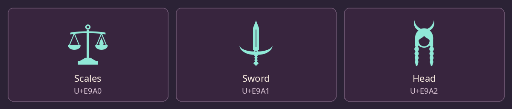

# Aura Soulflame theme collection

Start in the repository or the extracted release. The supplied pack is at `assets/character/`. Each component can be installed on its own. Images that depict Aura are fan art for personal, non-commercial use and are not under the MIT license. See [ASSETS-LICENSE](../ASSETS-LICENSE).

| Component | Files | Where it appears |
| --- | --- | --- |
| Character art | [Sheets](../assets/character/art) and [portraits](../assets/character/portraits) | Artwork reference, Plasma startup, Night and panel |
| Animated cursors | [Poses](../assets/character/cursor) and [seven variations](../assets/cursors) | Xcursor settings on Linux |
| Wallpapers | [Six desktop and lock-screen images](../assets/character/wallpapers) | OS wallpaper picker or a Plasma wallpaper effect |
| Codex pet | [Manifest and atlas](../assets/character/pet) | Codex pet picker |
| Plasma shell and icons | [Style](../themes/plasma/styles/aura-soulflame) and [icons](../themes/plasma/icons/AuraSoulflame) | Panel, launcher, folders and system indicators |
| Orca | [App and terminal plugin](../themes/orca/aura-soulflame) and [CSS and artwork](../assets/orca) | App, editor, terminal and custom CSS |
| SDDM | [Qt 6 greeter](../themes/sddm/aura-soulflame) | Login screen before your Plasma session |
| Aura Symbols | [OpenType font](../themes/sddm/aura-soulflame/AuraSymbols.otf) | Three glyphs used by the login and boot menus |
| Boot | [GRUB](../themes/grub/aura-soulflame), [Plymouth](../themes/plymouth/aura-soulflame) and [Plymouth Classic](../themes/plymouth/aura-soulflame-classic) | Boot menu and boot splash |

## Character components and Plasma

Use a subset of the modules for your environment. This example installs the character resources, Plasma style, icons and Night lock screen on Linux.

```sh
python3 aura.py plan --assets assets/character --modules cursor wallpapers codex-pet plasma-style plasma-icons plasma-lock
python3 aura.py install --assets assets/character --modules cursor wallpapers codex-pet plasma-style plasma-icons plasma-lock
python3 aura.py status --modules cursor wallpapers codex-pet plasma-style plasma-icons plasma-lock
```

- **Cursors** · Select **Aura SD - Poses** in the system cursor picker. To try a variation, copy its directory from `assets/cursors/` into the `icons/` directory of your XDG data home (usually `~/.local/share/icons/`). Use `cp -a` or extract on Linux to retain cursor aliases. The variants use the local Breeze cursor theme for fallback shapes.
- **Wallpapers** · Browse to the installed files reported by `status`, or open an image directly from `assets/character/wallpapers/`. `Aura-Night-Charge-Lock.png` frames the subject for a lock screen. **Aura Soulflame Drift** accepts any of the bundled images in its wallpaper settings.
- **KDE Plasma 6** · Select **Aura Soulflame Night** in **Screen Locking → Appearance → Wallpaper type**. Select **Aura · Soulflame** under **Plasma Style** and **Icons**. Set the application launcher's icon to `aura-soulflame-launcher` if you want the portrait there.
- **Splash and panel** · Add `plasma-splash plasma-panel` to the plan and install commands to use the five included poses. Pick **Aura Soulflame Splash** in System Settings and **Aura Soulflame Panel** in Add Widgets.
- **Codex** · Open the pet picker (or run `/pets` in a compatible Codex terminal) and select **아우라** (`aura`). For only the pet and wallpapers on Windows, run `py -3 aura.py plan --assets assets/character --modules codex-pet wallpapers` and replace `plan` with `install` to apply. On macOS use `python3`.

If you already installed the portable effects, inspect `status` before switching. To switch a managed copy whose status is `installed`, select a different effect in Plasma, uninstall that module, and run the new plan with `--assets assets/character`. Keep a separate copy of any settings or assets you edited. See the [asset layout](assets.md) to supply your own artwork.

## Orca IDE

Orca 1.4.246 and later can load the native data plugin. Open Orca, turn on plugins in **Settings → Plugins**, and add `themes/orca/aura-soulflame` under **Development folders**. The equivalent command from the repository root is below. Then choose **Aura Soulflame** in the appearance and terminal theme pickers. To undo, choose your previous themes and remove the development folder. [Orca plugin guide](https://github.com/stablyai/orca/blob/main/docs/reference/plugin-authoring.md)

```sh
orca plugin validate ./themes/orca/aura-soulflame
orca plugin dev load ./themes/orca/aura-soulflame
```

The original [CSS overlay and its backgrounds](../assets/orca) are available for environments that support custom CSS. Keep the CSS and its referenced image in the same directory. Orca's standard plugin loads the JSON colors and token colors. Terminal background images from the CSS overlay require a separate CSS-capable setup.

## SDDM login and Aura Symbols

SDDM is the login screen shown before Plasma starts. Preview the Qt 6 theme in a window or spare X session using the Qt 6 greeter binary provided by your distribution.

```sh
sddm-greeter-qt6 --test-mode --theme "$PWD/themes/sddm/aura-soulflame"
```

With the standard SDDM theme directory, copy the theme and choose **Aura Soulflame** in Plasma's **Login Screen (SDDM)** settings. Record your current theme so you can switch back there. Distributions with a custom `ThemeDir` should use that directory. [SDDM theme settings](https://github.com/sddm/sddm/blob/develop/data/man/sddm.conf.rst.in)

```sh
sudo install -d /usr/share/sddm/themes/aura-soulflame
sudo cp -a themes/sddm/aura-soulflame/. /usr/share/sddm/themes/aura-soulflame/
```



The greeter loads [AuraSymbols.otf](../themes/sddm/aura-soulflame/AuraSymbols.otf) beside its QML. For other applications, install the font for your account, then choose **Aura Symbols** for the private-use glyphs `U+E9A0` (scales), `U+E9A1` (sword) and `U+E9A2` (head). On Linux, install it with these commands.

```sh
install -Dm644 themes/sddm/aura-soulflame/AuraSymbols.otf "${XDG_DATA_HOME:-$HOME/.local/share}/fonts/AuraSymbols/AuraSymbols.otf"
fc-cache -f
```

## Plymouth boot splash

On a system already using Plymouth, install the theme matching the Plymouth rendering module you use. The example below is for Arch/Fedora-style setups with `plymouth-set-default-theme -R` and Plymouth's `script` plugin installed. Record the theme printed by the first command. To switch back, run the last command with your previous theme. On other distributions, use the distribution's theme selection and initramfs rebuild commands. [Plymouth manual](https://man.archlinux.org/man/plymouth-set-default-theme.1.en)

```sh
plymouth-set-default-theme
sudo install -d /usr/share/plymouth/themes/aura-soulflame
sudo cp -a themes/plymouth/aura-soulflame/. /usr/share/plymouth/themes/aura-soulflame/
sudo plymouth-set-default-theme -R aura-soulflame
```

The Classic theme uses the `two-step` module and your distribution's already installed `spinner` prompt images. Copy `themes/plymouth/aura-soulflame-classic/` as above, then copy `bullet.png`, `capslock.png`, `entry.png`, `keyboard.png`, `keymap-render.png` and `lock.png` from `/usr/share/plymouth/themes/spinner/` into the installed Classic theme directory. Select `aura-soulflame-classic` and rebuild the initramfs.

## GRUB boot menu

Build the four GRUB bitmap fonts from installed Noto Serif, Noto Sans, Noto Sans Mono and the bundled Aura Symbols. The command needs `grub-mkfont` and Fontconfig. Copy the theme and generated fonts beside each other under your distribution's GRUB themes directory. This example assumes `/boot/grub`.

```sh
font_dir=$(mktemp -d)
sh themes/grub/aura-soulflame/build-fonts.sh "$font_dir"
sudo install -d /boot/grub/themes/aura-soulflame
sudo cp themes/grub/aura-soulflame/theme.txt themes/grub/aura-soulflame/*.png "$font_dir"/*.pf2 /boot/grub/themes/aura-soulflame/
```

Set `GRUB_THEME="/boot/grub/themes/aura-soulflame/theme.txt"` in your distribution's GRUB defaults. Regenerate with the command for your setup, for example `sudo grub-mkconfig -o /boot/grub/grub.cfg` on Arch or `sudo update-grub` on Debian. Restore the previous `GRUB_THEME` and regenerate to undo. [GNU GRUB configuration guide](https://www.gnu.org/software/grub/manual/grub/html_node/Simple-configuration.html)
